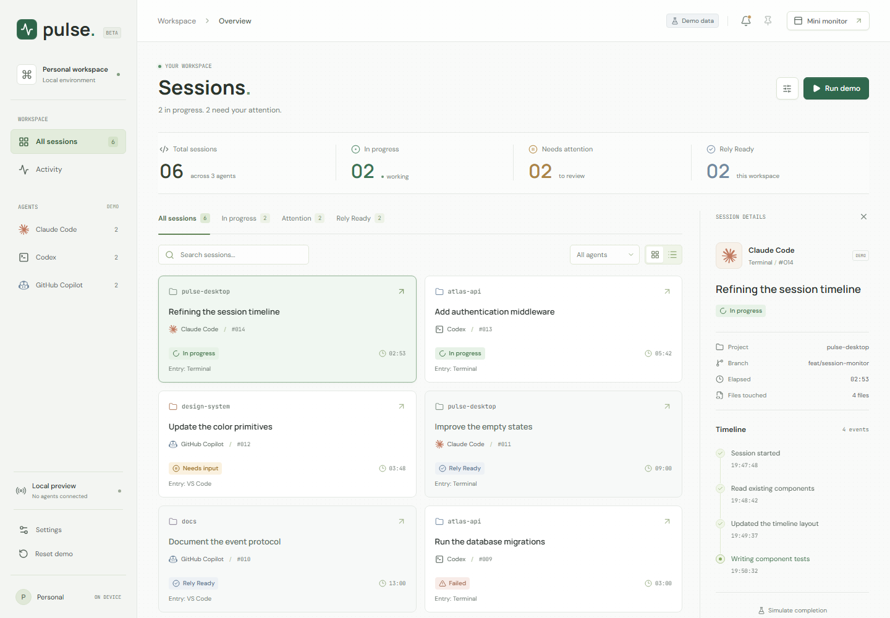
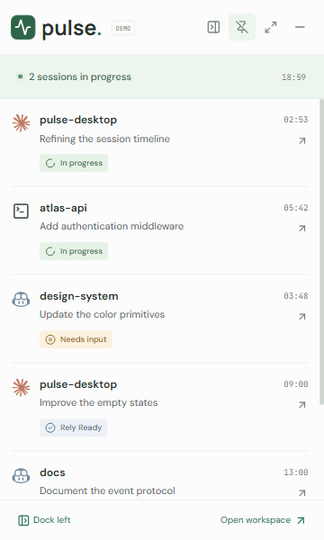

# Agent Pulse

Monitor agent sessions across projects and agent-specific source paths. Get notified when execution needs input, a reply is ready, or an error occurs.

[Website](https://liukun2634.github.io/agent-pulse/) | [Download for Windows](https://liukun2634.github.io/agent-pulse/download.html) | [Releases](https://github.com/liukun2634/agent-pulse/releases) | [Report an issue](https://github.com/liukun2634/agent-pulse/issues)

[](https://github.com/liukun2634/agent-pulse/actions/workflows/ci.yml)

Agent Pulse brings all discovered sessions from supported agents into one local workspace, even when their tools and session data live in different locations. Keep the compact monitor nearby while agents run, with one place to follow progress and pending reminders.

> Development preview for Windows x64. Monitor local VS Code / GitHub Copilot and independent Claude Code terminal sessions.



<details>
<summary>Mini monitor preview</summary>



</details>

Screenshots use Demo data. Claude Code snapshot monitoring is available; Codex is not connected yet.

## Features

- **Monitor across agent paths.** Bring local VS Code / GitHub Copilot and independent Claude Code sessions together without moving projects or combining their source directories.
- **See what needs attention.** Follow running sessions, input requests and ready replies at a glance, with active sessions checked every two seconds.
- **Keep progress in view.** Pin the mini monitor, dock it on either screen edge or collapse it into a narrow rail.
- **Stay focused.** Brief notifications let you know when to act without taking keyboard focus. Revisit pending reminders from the bell inbox.
- **Inspect recent activity.** Open a session's details and timeline directly in Pulse from the mini monitor or a reminder.
- **Keep the full monitoring scope.** Search by project, task or session ID, and archive or restore sessions without interrupting the agent. Lists retain source order; filtering and display pages never pause background monitoring.
- **Keep your data local.** No account, telemetry or model API key required. Your conversations stay on your device.

## Download and get started

Visit the **[Windows download page](https://liukun2634.github.io/agent-pulse/download.html)** for available builds and installation instructions. Release files are hosted on [GitHub Releases](https://github.com/liukun2634/agent-pulse/releases). If no installer is available yet, [try it from source](#development).

1. Install Agent Pulse on Windows. Packaged releases do not require Node.js.
2. Use your existing VS Code / GitHub Copilot setup or a separately installed Claude Code CLI. Pulse monitoring requires no additional editor extension.
3. Launch Pulse and select **Live** to see VS Code and Claude Code sessions together. Use the Agent filter to narrow the list, or **Mini monitor** to follow progress. **Demo** stays separate; switching views does not stop live monitoring.

> Preview builds are unsigned and may trigger Windows security warnings. Verify the download source and checksums; do not disable system security protections.

## Project status

Agent Pulse is a Windows development preview for local VS Code / GitHub Copilot and Claude Code sessions. More integrations and session navigation are still being developed. Features in the source build may not yet be included in the latest download. The browser preview uses sample data only.

Claude terminal navigation is experimental and limited to Windows Terminal. It requires an explicit tab or pane selection and never launches or resumes a Claude session. Reliable foreground switching is still under validation.

Keep Pulse running, including in the tray, to receive reminders. Pulse observes sessions without sending messages or approving permissions. An idle agent is not assumed to have finished its reply.

## Development

Built with Electron, React and TypeScript. Use **Node.js 24 LTS or newer** on Windows:

```sh
git clone https://github.com/liukun2634/agent-pulse.git
cd agent-pulse
npm ci
npm run desktop:dev
```

Use `npm run dev` for a browser-only Demo, or `npm run build:site` to build the project website.

Before opening a pull request, run `npm test`, `npm run build` and `npm run lint`, plus the tests relevant to your change.

## Contributing

See the [contribution guide](CONTRIBUTING.md) for reporting issues, proposing changes and submitting pull requests.

## License

Agent Pulse is licensed under the [Apache License 2.0](LICENSE). Third-party components retain their respective licenses.
